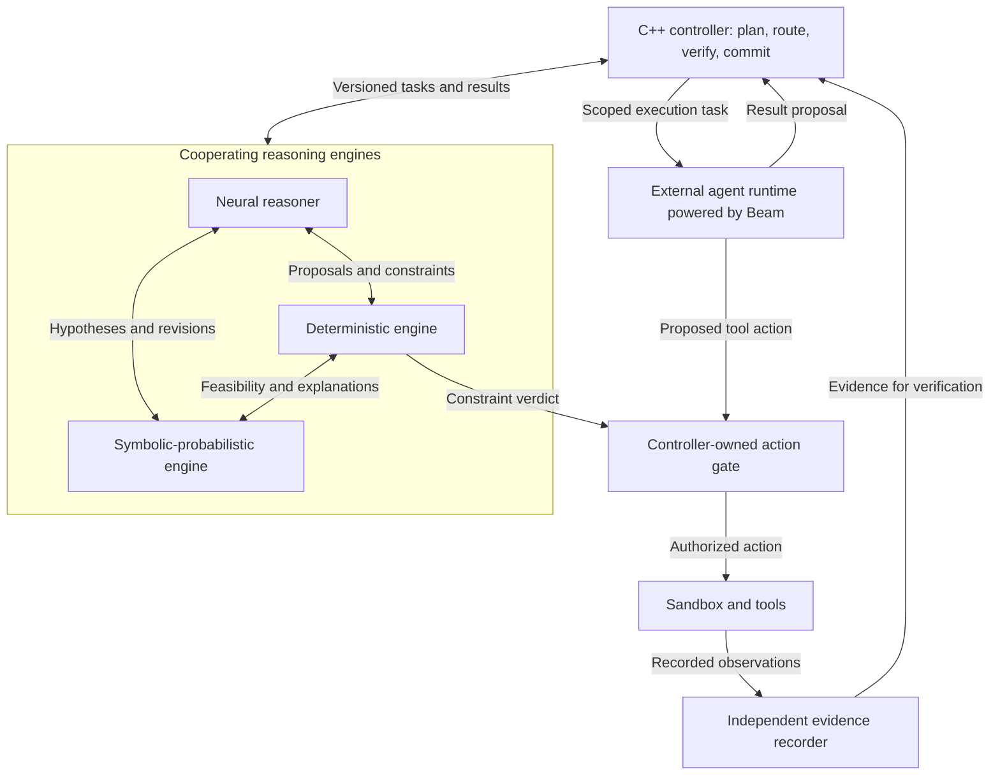

# Verified Hybrid AI

### Cooperative reasoning. Explicit constraints. Evidence-backed execution.

**An architecture proposal by Dino Silvestri.** Working project title; name availability has not been established.

Verified Hybrid AI brings three communicating reasoning engines under a C++ controller: a neural reasoner, a deterministic constraint engine, and a symbolic-probabilistic inference engine. The controller owns the plan and authoritative state. The engines exchange proposals, constraints, and intermediate conclusions. An external agent runtime powered by Beam handles execution when a task requires tools or a computer.

The central idea is simple: **let different engines reason together, while making acceptance and execution explicit, checkable decisions.**

**Status:** design proposal seeking technical feedback and collaborators. This repository contains the architecture, proposed contracts, and evaluation plan. It does not yet contain a working implementation or benchmark results.

## Why build this?

An agent can produce a plausible answer, call tools, and announce success while leaving important questions unanswered: Which constraints did it check? What actually ran? Does the evidence refer to the current artifact? Did another agent independently confirm the result, or merely repeat it?

This architecture makes those questions part of the execution path. A promising proposal can be revised through communication between engines. A hard constraint cannot be relaxed merely because a model is confident. A completed action must return evidence tied to the task and resulting artifact before it changes accepted state.

The research hypothesis is that this arrangement can improve task reliability and auditability enough to justify its coordination cost. That hypothesis needs measurement.

## The architecture

The diagram shows logical authority, not deployment requirements. The engines may run in separate processes or services. Evidence recording also covers internal checks and state transitions, although those edges are omitted for readability.

| Component | Responsibility | Authority boundary |
| --- | --- | --- |
| C++ controller | Maintain the task graph and state, schedule work, evaluate acceptance, commit results | Sole authority to update accepted state and issue execution capabilities |
| Neural engine | Generate hypotheses, plans, interpretations, and candidate solutions | Proposes; cannot certify its own claims |
| Deterministic engine | Apply explicit rules, solve formal constraints, check structured results | Reports what passed, failed, or could not be established under a specific rule set |
| Symbolic-probabilistic engine | Combine structured hypotheses and uncertain observations; rank feasible alternatives | Cannot override hard constraints or turn confidence into proof |
| External Beam-powered runtime | Run bounded tool-using loops and return artifacts | Operates within controller-issued capabilities; consequential actions are gated |
| Evidence recorder | Capture actual tool activity and verification events in an append-only log | Signing and log-writing authority remain outside model control |

## The communication loop is part of the design

The three engines cooperate throughout a task. The neural engine proposes a candidate; the deterministic engine supplies violated constraints or feasibility results; the symbolic-probabilistic engine revises the ranking of alternatives; the neural engine can then generate a better candidate. All exchanges carry task identity, state version, and evidence ancestry.

For example, a code-repair task might proceed as follows:

1. The controller fixes the repository revision, allowed edits, time budget, and acceptance checks.
2. The neural engine proposes a repair plan. The deterministic engine checks its declared actions against scope and policy.
3. The symbolic-probabilistic engine ranks feasible plans using explicit assumptions and available observations.
4. The controller delegates the selected execution task to a Beam-powered runtime.
5. The runtime proposes tool calls; an action gate checks them before execution. A sandbox records commands, outputs, and artifact identities independently of the model.
6. The reasoning engines receive the observed outcome. Failed tests can drive a bounded revision loop.
7. The controller commits a result only when its specified acceptance checks pass against the exact candidate artifact. Otherwise it rejects, requests revision, or reports an unresolved task.

Passing a test suite establishes the recorded test result. It does not prove that the program is correct in every possible situation.

## Integration choices

- **A2A:** agent-level task communication, intermediate artifacts, and status exchange. A2A v1.0 provides an interoperability foundation; application schemas define the meaning of each message.
- **MCP:** structured access to tools and services, including a deterministic checker exposed as a tool service. The C++ host can consume checker results through an MCP client. MCP is not inherently a proof or exactness mechanism.
- **PCM-inspired evidence:** typed claims backed by independently recorded events, authenticated log commitments, and verifier checks. The first implementation will not claim PCM conformance without passing its relevant conformance requirements.
- **GURU-inspired authority:** learned components propose; explicit rules constrain; a validated, task-specific acceptance path decides.
- **REASON-inspired structure:** represent suitable symbolic and probabilistic work as explicit computation graphs. The proposed software prototype does not depend on REASON hardware or claim its acceleration results.
- **Beam:** the initial proposed execution model inside an external agent harness. Beam is developed by Reflection and was previewed as MISSINGNO through Nous Portal. Harness, sandbox, inference provider, and tool services remain separate components. Free access is not a system invariant.

For tightly coupled local operations, direct calls or local IPC may be more appropriate than serializing every exchange through an agent protocol. That optimization must preserve the same contracts and authority boundaries.

## What this project contributes

The proposed contribution is the integration: three continuously cooperating reasoning roles, one authoritative controller, execution-time enforcement, and evidence-bound state updates.

The project builds on neuro-symbolic reasoning, multi-agent coordination, formal checking, and evidence-carrying communication. It makes no claim that these individual ideas are new or that this combination is the first of its kind. Establishing novelty requires a broader literature review and comparison with implemented systems.

This is a system architecture rather than a newly pretrained LLM. “Mixture of experts” describes the task-level cooperation informally; it does not imply that these services share a learned token router or jointly trained weights.

## First prototype and success criteria

Start with sandboxed code repair, where artifacts and verification outcomes can be captured precisely. Compare the full system with the same execution model used alone and with simpler checker-based configurations under matched budgets.

Measure task success, false acceptance, constraint violations, unresolved tasks, latency, token consumption, and total execution cost. Test stale evidence, repeated claims, contradictory constraints, tool timeouts, and failed verification explicitly.

The project succeeds only if the additional structure produces a measured benefit. A more complicated architecture is not automatically a more capable one.

## Read more

- [Control and evidence contract v0.2](docs/CONTROL_CONTRACT.md)
- [Architecture and execution contracts](docs/ARCHITECTURE.md)
- [Prototype roadmap and evaluation](docs/ROADMAP.md)
- [Community pitch and repository description](docs/COMMUNITY_PITCH.md)
- [Sources and relationship to prior work](docs/REFERENCES.md)
- [Research review and qualifications](docs/RESEARCH_REVIEW.md)
- [How to contribute](CONTRIBUTING.md)

## Feedback wanted

The v0.2 design adds explicit hard/soft constraint handling, acceptance receipts, narrowing capability grants, protected grading, and bounded escalation. These additions make the proposal easier to falsify and audit; they do not add another reasoning engine or claim new performance results.

I am looking for feedback from people working on agent runtimes, formal verification, probabilistic inference, and C++ systems. In particular:

- What should the smallest shared representation between these three engines look like?
- Which claims can be independently checked at reasonable cost?
- Where does iterative fusion outperform a simpler propose-and-check loop?
- What benchmark would most clearly falsify or support the architecture's central hypothesis?

Design criticism, counterexamples, and scoped implementation proposals are welcome. Please tie proposals to a concrete task and measurable outcome.

## Authorship and licensing

Architecture concept by **Dino Silvestri**. Documentation prepared with AI assistance from the author's description and refined through technical review. Referenced protocols, models, and papers remain the work of their respective creators.

No license has been selected for these repository materials. Public availability alone does not grant an open-source license; licensing should be decided before accepting implementation contributions intended for redistribution.
